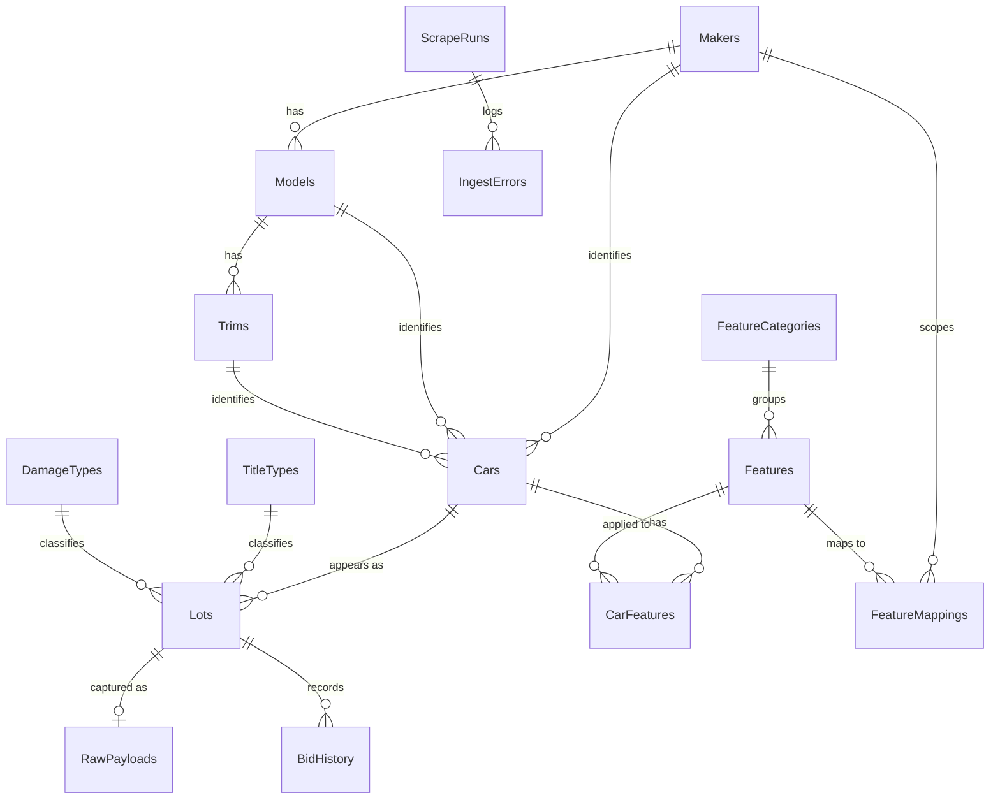

# Car Auction Price Intelligence — Implementation Plan

**Status:** Draft v3 · 2026-10-16 · (v3 adds manufacture year + configurable collection/start filters)
**Goal:** A private, single-user tool that collects vehicle data and final sale prices from
Copart and IAAI (plus free/auxiliary sources), stores it in a local file database, and runs
statistics to support personal car-buying decisions.

---

## 1. Guiding constraints & data realities

These shaped every design decision below. Read them first.

1. **Current bid ≠ final sale price.** Copart's and IAAI's public interfaces list *upcoming*
   lots with *live* bids. There is no public archive of historical final prices. We get final
   prices two ways: **(a) capture the high bid at the moment a lot closes** (our own collector),
   or **(b) import an archive** that already did that (VinCheck free index, consumer sites, paid APIs).
   → The schema separates a physical **Car** from each **Lot** (auction appearance) so a car
   relisted three times has one Car row and three Lot rows, each with its own price/status.

2. **VINs are often masked.** Public listings frequently hide the last 6–8 VIN characters
   (e.g. `4T1BF3EK2AU******`). The first 11 characters (WMI + VDS + check digit) still decode
   make/model/trim/engine/plant, but a masked VIN **cannot uniquely identify the physical car or
   pull full factory options.** We dedupe lots by source lot number, store a `VinPattern` (first 11),
   and treat a full VIN as a bonus when present. **Copart masks the VIN in text but prints the full
   VIN on the lot-label placard and factory stickers *in the photos*, so we recover it via barcode
   decode + OCR (see §10)** — which then unlocks the full-VIN-only paths (dedup, factory options).

3. **Listing feeds contain almost no option-level features.** Copart/IAAI give damage, odometer,
   title, drivetrain, basic specs, and photos — **not** "adaptive cruise / 360 camera / AWD-as-option".
   Features are a separate enrichment problem with its own data sources (see §9). Treat it as phased,
   not free.

4. **Both sites run Imperva/Incapsula bot protection.** A real browser passes; plain HTTP clients get
   challenged. The collector uses **Playwright with a persistent browser context** and calls the JSON
   endpoint *from inside a warmed-up page* (so Incapsula cookies/JS are present). Low volume + jitter.

5. **The dev sandbox has no outbound network.** Scrapers run as a real process on the user's machine
   (Worker/CLI), never through the sandboxed shell.

6. **SQLite is single-writer.** We enable WAL mode; the **Worker is the only writer**, the API reads.
   Good enough for one user. DuckDB is noted as an option if analytics get heavy.

---

## 2. High-level architecture

```
                 ┌─────────────────────────────────────────────┐
                 │                 SQLite (WAL)                 │
                 │   car.db  — single local file database       │
                 └───────▲─────────────▲───────────────▲────────┘
                         │ write        │ read          │ read/write
          ┌──────────────┴───┐   ┌──────┴───────┐   ┌───┴────────────┐
          │  Worker (jobs)   │   │   Web API    │   │   CLI (admin)  │
          │  scrape/enrich/  │   │ ASP.NET Core │   │  manual ops    │
          │  rollup on cron  │   │  + serves UI │   │                │
          └───▲────────▲─────┘   └──────▲───────┘   └────────────────┘
              │        │                │ HTTP/JSON
   Playwright │        │ HTTP           │
     (Copart, │        │ (vPIC, VinCheck)      ┌──────────────────────┐
      IAAI)   │        │                       │  React UI (Vite/TS)  │
              ▼        ▼                        │  dashboard/search/…  │
        Copart/IAAI  NHTSA vPIC / VinCheck      └──────────────────────┘
```

Three deployable processes (Worker, API, CLI) share two libraries (Domain, Infrastructure) and one
database file. The React app is built to static files and served by the API (dev: Vite dev server
with a proxy to the API).

---

## 3. Solution / repository layout

```
C:\car\
├─ CarPrices.sln
├─ docs\
│   └─ IMPLEMENTATION_PLAN.md          ← this file
├─ data\
│   └─ car.db                          ← SQLite file (git-ignored)
├─ src\
│   ├─ CarPrices.Domain\               # entities, enums, value objects — no external deps
│   ├─ CarPrices.Infrastructure\       # EF Core DbContext, migrations, repositories, SQLite setup
│   ├─ CarPrices.Normalization\        # maker/model/trim + feature normalization engine
│   ├─ CarPrices.Scraping\             # Playwright host, anti-bot, Copart/IAAI/VinCheck clients
│   ├─ CarPrices.Enrichment\           # VIN decode (vPIC), feature extraction
│   ├─ CarPrices.Vision\               # VIN-from-image: barcode decode + OCR + validation
│   ├─ CarPrices.Statistics\           # rollup/aggregation computation (percentiles in C#)
│   ├─ CarPrices.Api\                  # ASP.NET Core Minimal API; serves React build
│   ├─ CarPrices.Worker\               # BackgroundService + scheduler (scrape/enrich/rollup)
│   └─ CarPrices.Cli\                  # `dotnet run -- scrape copart --make bmw` etc.
├─ web\                                # React + Vite + TypeScript frontend
│   ├─ src\
│   └─ package.json
└─ tests\
    ├─ CarPrices.UnitTests\
    └─ CarPrices.IntegrationTests\
```

**Dependency direction:** Domain ← Infrastructure ← (Normalization, Scraping, Enrichment, Statistics)
← (Api, Worker, Cli). Domain depends on nothing.

---

## 4. Database design

### 4.1 Entity-relationship overview



### 4.2 Taxonomy tables

**Makers** — `Id` PK · `Name` · `NormalizedName` (unique) · `CountryCode` · `CreatedAt`
**MakerAliases** — `Id` · `MakerId` FK · `Alias` (unique) · `Source` — maps `VW`/`Volkswagen`/`VOLKSWAGEN` → one maker
**Models** — `Id` PK · `MakerId` FK · `Name` · `NormalizedName` · `DefaultBodyStyle` · unique(`MakerId`,`NormalizedName`)
**ModelAliases** — `Id` · `ModelId` FK · `Alias` · `Source`
**Trims** — `Id` PK · `ModelId` FK · `Name` · `NormalizedName` · `EngineCode?` · unique(`ModelId`,`NormalizedName`)
**TrimAliases** — `Id` · `TrimId` FK · `Alias` · `Source`

*Why aliases:* Copart, IAAI, and vPIC spell makes/models/trims differently ("MERCEDES-BENZ" vs
"Mercedes", "3-SERIES" vs "3er" vs "330i"). Raw text is mapped to canonical rows via alias tables;
unmapped strings land in a review queue.

### 4.3 Vehicle & auction tables

**Cars** (one physical vehicle)
`Id` PK · `Vin?` (unique when present) · `VinPattern` (first 11, indexed) · `MakerId` FK ·
`ModelId` FK · `TrimId?` FK · `ModelYear` · `ManufactureYear?` · `BodyStyle` · `DriveType` · `FuelType` ·
`Transmission` · `EngineDisplacement` · `EngineCylinders` · `EngineDescription` · `ExteriorColor` ·
`VinSource` (enum: TextField/PhotoBarcode/PhotoOcr/Manual) · `VinConfidence?` ·
`VinDecoded` (bool) · `VinDecodedAtUtc?` · `CreatedAt` · `UpdatedAt`

*Year fields: `ModelYear` = the model-year designation (VIN position 10 / listing text).
`ManufactureYear` = the actual production year from the door-jamb build date (via image VIN step §10
or build-data). The two can differ by up to a year; stats and filters default to `ModelYear`.*

**Lots** (one auction appearance)
`Id` PK · `CarId` FK · `Source` (enum: Copart/IAAI/StatVin/BidFax/…) · `SourceLotNumber` (indexed) ·
`LotUrl` · `AuctionDateUtc?` · `SaleStatusRaw` · `SaleStatus` (enum: Upcoming/Live/Sold/NotSold/
OnApproval/Cancelled) · `YardCode` · `LocationCity` · `LocationState` · `LocationCountry` ·
`TitleTypeId?` FK · `TitleState` · `PrimaryDamageId?` FK · `SecondaryDamageId?` FK · `Odometer?` ·
`OdometerUnit` · `OdometerBrand` (Actual/NotActual/Exempt) · `HasKeys?` · `RunAndDrive` (enum) ·
`EstimatedRetailValue?` (ACV) · `RepairCostEstimate?` · `CurrentBid?` · `BuyNowPrice?` · `FinalBid?` ·
`SalePrice?` · `Currency` · `IsSold` (bool) · `SaleCapturedAtUtc?` · `FirstSeenUtc` · `LastSeenUtc` ·
`RawPayloadId?` FK · unique(`Source`,`SourceLotNumber`,`AuctionDateUtc`)

**RawPayloads** — `Id` · `Source` · `SourceLotNumber` · `CapturedAtUtc` · `ContentType` (json/html) ·
`Content` (compressed) — lets us re-normalize without re-scraping.
**BidHistory** (phase 4+) — `Id` · `LotId` FK · `BidAmount` · `BidTimeUtc` · `Source`.
**LotImages** — `Id` · `LotId` FK · `Url` · `Kind` (Label/Jamb/VinPlate/Dash/Exterior/Interior/Unknown) ·
`Sequence` · `LocalPath?` · `Width?` · `Height?` · `OcrProcessed` (bool) · `CapturedAtUtc` — the photo
set per lot; the VIN-recovery pipeline reads these.

### 4.4 Feature tables

**FeatureCategories** — `Id` · `Name` (Safety/Comfort/Infotainment/Drivetrain/Exterior/…)
**Features** (canonical catalog) — `Id` · `Code` (unique, e.g. `ADAPTIVE_CRUISE`, `CAMERA_360`,
`AWD`) · `DisplayName` · `CategoryId` FK · `Description`
**CarFeatures** — `Id` · `CarId` FK · `FeatureId` FK · `Source` (enum: VinDecode/BuildData/
ListingText/Photo/Manual) · `Confidence` (0–1) · `FirstSeenAtUtc` · unique(`CarId`,`FeatureId`,`Source`)
**RawOptions** — `Id` · `CarId?` FK / `VinPattern?` · `MakerId` FK · `RawCode?` · `RawText` ·
`Source` — raw option strings before mapping.
**FeatureMappings** (normalization rules) — `Id` · `MakerId?` FK (null = global) · `MatchType`
(Exact/Contains/Regex) · `Pattern` · `FeatureId` FK · `Priority` — turns raw option text/codes into
canonical Features; per-maker because naming differs.

### 4.5 VIN decode cache

**VinDecodes** — `Id` · `VinOrPattern` (unique) · `Source` (vPIC/BuildData) · `DecodedAtUtc` ·
`RawJson` · extracted columns (`MakerName`,`ModelName`,`TrimName`,`ModelYear`,`BodyClass`,
`DriveType`,`FuelType`,`EngineModel`,`PlantCountry`, …). Avoids re-decoding and caps API calls.

**VinExtractions** (image-VIN audit) — `Id` · `LotId` FK · `LotImageId?` FK · `Method` (Barcode/Ocr) ·
`Engine` (ZXing/Tesseract/Azure/…) · `RawText` · `CandidateVin` · `CheckDigitValid` (bool) ·
`MatchesMaskedPattern` (bool) · `Confidence` · `Accepted` (bool) · `CreatedAtUtc` — logs every
recovery attempt for audit and retry.

### 4.6 Aggregate / statistics tables

**PriceStats** (precomputed rollups) — `Id` · dimension keys (`DimMakerId?`,`DimModelId?`,
`DimTrimId?`,`DimModelYear?`,`DimTitleGroup?`,`DimDamageGroup?`,`DimRegion?`) · `PeriodType`
(All/Year/Quarter/Month/Rolling90) · `PeriodKey` · `SampleSize` · `MinPrice` · `MaxPrice` ·
`MeanPrice` · `MedianPrice` · `P25` · `P75` · `P90` · `StdDev` · `MeanOdometer` · `ComputedAtUtc`
**FeaturePriceImpact** — `Id` · `FeatureId` FK · `SegmentKey` · `WithN` · `WithoutN` · `MeanWith` ·
`MeanWithout` · `DeltaAbs` · `DeltaPct` · `ComputedAtUtc`
**PriceIndexDaily** (time series) — `Id` · `SegmentKey` · `Date` · `MedianPrice` · `SampleSize`
**VinCheckIndex** (imported reference) — `Id` · `ModelYear` · `Maker` · `Model` · `SampleSize` ·
`P25` · `P50` · `P75` · `GeneratedAtUtc` · `Source=VinCheck`

> **SQLite has no native percentile function.** Percentiles (median/P25/P75/P90) are computed in the
> `CarPrices.Statistics` project in C# (load sorted price arrays per segment), then written to
> PriceStats. Rollups run nightly; dimension combinations are capped to meaningful segments
> (min sample size, e.g. ≥ 5 sold lots).

### 4.7 Lookups & ops

**TitleTypes** — `Id` · `Code` · `Description` · `Group` (Clean/Salvage/Rebuilt/Junk/…)
**DamageTypes** — `Id` · `Code` · `Description` · `Group`
**ScrapeRuns** — `Id` · `Source` · `JobType` · `StartedAtUtc` · `FinishedAtUtc?` · `Status` ·
`LotsSeen` · `LotsNew` · `LotsUpdated` · `PricesCaptured` · `ErrorCount` · `Notes`
**IngestErrors** — `Id` · `ScrapeRunId` FK · `Stage` · `SourceLotNumber?` · `Message` · `Payload?` ·
`CreatedAtUtc`
**CollectionTargets** — `Id` · `MakeText`/`MakerId?` · `ModelText`/`ModelId?` · `TrimText?` ·
`YearFrom?` · `YearTo?` · `TitleGroups?` · `Regions?` · `Sources?` · `Enabled` (bool) · `CreatedAt` —
the scoped set of searches the collector runs (seeded from config, editable via CLI/UI). No enabled
target = collect nothing, so the first runs stay small. See §5.11.

### 4.8 Indexing & settings
- WAL journal mode, `synchronous=NORMAL`, busy_timeout set.
- Indexes: `Cars(VinPattern)`, `Cars(MakerId,ModelId,TrimId,ModelYear)`, `Lots(CarId)`,
  `Lots(Source,SourceLotNumber)`, `Lots(AuctionDateUtc)`, `Lots(IsSold,SaleStatus)`,
  `PriceStats(DimMakerId,DimModelId,DimModelYear,PeriodType)`.

---

## 5. The applications (detail)

### 5.1 CarPrices.Domain
Pure C# entities + enums (`Source`, `SaleStatus`, `RunAndDrive`, `FeatureSource`, `PeriodType`,
`TitleGroup`, `DamageGroup`). Value objects for `VinPattern`, `Money`. No framework dependencies —
keeps the model testable and reusable by every app.

### 5.2 CarPrices.Infrastructure
EF Core 10 `AppDbContext`, entity configurations (fluent), migrations, SQLite provider + WAL setup,
repositories/query services, and a `DbInitializer` that seeds lookups (TitleTypes, DamageTypes,
FeatureCategories, seed Features, and known maker/model aliases).

### 5.3 CarPrices.Scraping
All collection is **scoped by configured collection targets** (see §5.11) — the clients translate each
target (make / model / year-range / source / title) into site searches, so we never crawl the whole
catalog, only the cars you care about.
- **`PlaywrightBrowserFactory`** — manages a persistent context (profile dir), realistic UA/headers,
  stealth tweaks, configurable proxy, concurrency limiter, jittered delays, challenge detection +
  backoff.
- **`CopartClient`** — warms a page, then `page.EvaluateAsync` → `POST /public/lots/search-results`.
  Maps the ~130 short-key fields (`hb`,`bnp`,`ad`,`lad`,`ss`,`lsts`,`mkn`,`lmg`,`lcy`,`ltd`,`yn`,
  title/damage/odometer…) into DTOs. Slices searches (by make/model/date/yard) to stay under the
  ~50-page pagination cap. Optionally pulls lot detail (note: `/public/data/…` is robots-disallowed).
- **`IaaiClient`** — navigates `GET /Search?url=cars&Keyword=…`, parses server-rendered HTML
  (AngleSharp), handles Incapsula challenge pages. Live bids via the `timedauctionhub` SignalR hub
  (phase 4, optional).
- **`VinCheckImporter`** — downloads the CSV/JSON aggregate index → `VinCheckIndex`.
- **`ConsumerSiteClients`** (stat.vin / bidfax, phase 4) — historical sold-price backfill.
- All clients emit normalized `ScrapedLot` DTOs + raw payloads; they do not touch the DB directly
  (an ingestion service does the upsert).

### 5.4 CarPrices.Enrichment & CarPrices.Vision
- **`VinDecodeService`** — NHTSA vPIC `POST /vehicles/DecodeVINValuesBatch/` (free, batchable),
  cached in `VinDecodes`. Fills/validates Car specs; cross-checks maker/model/trim against taxonomy.
- **`FeatureExtractor`** — turns available signals into `CarFeatures` via `FeatureMappings`
  (see §9). Phase A: vPIC standard equipment + structured listing fields. Later: build-data / photos.
- **`VinImageExtractor`** (`CarPrices.Vision`) — recovers the full VIN from lot photos (barcode decode
  → OCR fallback → check-digit + masked-pattern validation) when the text VIN is masked. Full detail in §10.

### 5.5 CarPrices.Normalization
- **`TaxonomyResolver`** — resolves raw maker/model/trim strings to canonical IDs via alias tables;
  queues unknowns for review; can auto-create with low confidence.
- **`FeatureNormalizer`** — applies `FeatureMappings` (exact/contains/regex, per-maker priority) to
  raw options → canonical `Features`.

### 5.6 CarPrices.Statistics
Recomputes PriceStats, FeaturePriceImpact, PriceIndexDaily from **sold** lots. Percentiles computed
in C#. Exposes a `StatisticsService` the API queries. Also a **price estimator**: given a target
(VIN pattern / make-model-trim-year + mileage + title + damage), return the comparable-sold
distribution and a suggested fair bid.

### 5.7 CarPrices.Api
ASP.NET Core Minimal APIs (EF Core read side). Endpoints (sketch):
- `GET /api/taxonomy/makers|models|trims`
- `GET /api/lots?filters…` (make/model/trim/year/title/damage/features/price/mileage/region/source/sold)
- `GET /api/cars/{id}` · `GET /api/lots/{id}` (specs, features, price history, comparables)
- `GET /api/stats/price?dims…` · `GET /api/stats/trend?…` · `GET /api/stats/feature-impact?…`
- `POST /api/estimate` (price estimator)
- `GET /api/ops/scrape-runs` (health)
Serves the built React app as static files.

### 5.8 CarPrices.Worker
`BackgroundService` + scheduler (Quartz.NET or Coravel). Jobs in §8. Single writer to the DB.

### 5.9 CarPrices.Cli
Thin command layer over the same services for manual runs/debugging:
`scrape copart --make bmw --model 3`, `enrich vin`, `stats rollup`, `import vincheck`, `db migrate`.

### 5.10 web (React UI)
Vite + React + TypeScript + TanStack Query + Recharts + Tailwind. Pages:
- **Dashboard** — market overview, indices, headline charts.
- **Search/Browse** — rich filters (incl. features), results grid/table, photos.
- **Car/Lot detail** — specs, features, price history, comparable sold lots.
- **Statistics explorer** — pick dimensions → distribution, price-vs-mileage, trend charts.
- **Feature impact** — "how much does X add?" across a segment.
- **Price estimator** — paste a VIN/lot → fair-price range.
- **Watchlist / alerts** (phase 5).

> ⚠️ **Node upgrade required.** Detected Node v10.23.0 is too old for Vite. Install Node 20 LTS+.

### 5.11 Configuration & collection scope (start filters)
To avoid pulling the entire catalog, collection is driven by **collection targets** — a configurable
filter set. At start they live in `appsettings.json` (seeded into the `CollectionTargets` table,
editable later via CLI/UI). The scrapers only search for lots matching an **enabled** target, so you
begin narrow (e.g. *BMW 3 Series from 2020*) and widen over time.

```jsonc
// appsettings.json
"Collection": {
  "Targets": [
    {
      "make": "BMW", "model": "3 Series", "trim": null,
      "yearFrom": 2020, "yearTo": null,
      "sources": ["Copart", "IAAI"],
      "titleGroups": ["Clean", "Salvage"],
      "regions": null,
      "enabled": true
    }
  ],
  "MaxPagesPerSearch": 50,
  "IncludeUpcoming": true,
  "IncludeSold": true
}
```
- `make` / `model` / `trim` resolve through the alias tables, so "3 Series" / "3er" / "330i" all match.
- `yearFrom` / `yearTo` filter by **model year** (`null` = open-ended); add `yearField: "manufacture"`
  to filter on manufacture year instead.
- Each enabled target becomes one or more scoped site searches; add targets to widen scope
  incrementally. Keeping the set small is good for both anti-bot posture and relevance, and makes the
  first runs fast.

---

## 6. Data pipeline

```
scrape → raw payload store → taxonomy normalize (maker/model/trim) → upsert Car + Lot
       → store LotImages → if text VIN masked/absent: barcode/OCR recover + validate → set full VIN
       → VIN decode (vPIC, cached) → feature extract + normalize → CarFeatures
       → (on lot close) capture final bid → SalePrice/IsSold
       → nightly rollup → PriceStats / FeaturePriceImpact / PriceIndexDaily
       → API → React UI
```
Every stage is idempotent and keyed on `(Source, SourceLotNumber)`; raw payloads allow full
re-processing after mapping-rule changes.

---

## 7. Statistics & analytics
Distributions and percentiles by make/model/trim/year/title/damage/region; price-vs-mileage curves;
trend/index over time; **feature price impact** (mean sold price with vs without a feature, within a
segment); **fair-price estimator** (median/IQR of comparable sold lots + mileage/damage adjustment).
Guardrails: minimum sample sizes, outlier trimming, "current bid" explicitly excluded from
sold-price stats.

---

## 8. Scheduling (Worker jobs)
| Job | Cadence | Purpose |
|---|---|---|
| Discovery scrape (Copart, IAAI) | 1–3×/day | capture upcoming lots + current specs |
| **Close capture** | hourly around sale windows | re-poll lots past `AuctionDate` → record final bid/sale |
| **VIN-from-image** | after discovery, for masked/missing VINs | recover full VIN (barcode + OCR) before decode |
| VIN decode | continuous queue | decode new cars (batch vPIC), cache |
| Feature extract | after decode | build CarFeatures |
| VinCheck import | daily | refresh aggregate index |
| Stats rollup | nightly | recompute PriceStats / impacts / index |

---

## 9. Feature parsing & normalization strategy (the hard part)
Listing feeds don't carry option-level features, so features come from, in order of effort:
- **Phase A (free, baseline):** NHTSA vPIC standard equipment + structured listing fields
  (drivetrain, fuel, body) → canonical Features via `FeatureMappings`. Covers things like AWD,
  fuel type, body style; weak on options like "360 camera".
- **Phase B (paid, accurate):** a build-data / window-sticker-by-VIN provider (e.g. DataOne,
  Chrome Data / JD Power, Vehicle Databases specs-&-options) → real factory options. Requires a
  full (unmasked) VIN, which salvage listings mask in text but expose in photos (recovered via §10).
- **Phase C (ML, enhancement):** parse listing descriptions + run image recognition on interior/
  dash photos to infer features (360-cam screen, ACC stalk). Lower confidence; big effort.
Each detected feature stores its `Source` + `Confidence`, so the UI can show how a feature was
determined and stats can weight by confidence.

---

## 10. VIN recovery from images (barcode + OCR)

**Why:** Copart masks the VIN in text data, but the **full VIN is legible in the lot photos** — on
Copart's printed lot-label placard and on factory stickers (driver door-jamb, windshield base).
Recovering it unlocks everything that needs a full VIN: unique car identity & dedup, factory
options/features (build-data), and complete history.

**Target images, best first:**
1. **Copart lot-label placard** — the printed sheet in the photo set; consistent layout, usually a
   **barcode + printed VIN**. Highest-value, most reliable target.
2. **Driver door-jamb sticker** — factory sticker, typically with a **Code 39 barcode** of the VIN.
3. **Windshield VIN plate / dashboard VIN** — OCR-only (small, angled, lower confidence).

**Pipeline (`CarPrices.Vision`):**
1. **Collect** lot image URLs (from Copart's image endpoint) → `LotImages`.
2. **Prioritize** images likely to contain the VIN. Phase A: heuristics (Copart's label shot sits at a
   predictable position in the set). Phase B: a lightweight ONNX detector to locate VIN/barcode regions.
3. **Barcode decode first — `ZXing.Net`** (Code 39 / Code 128 / Data Matrix / PDF417 / QR). A clean
   17-char decode is high confidence and cheap — this is the primary path.
4. **OCR fallback** — preprocess with SkiaSharp/OpenCvSharp (grayscale, upscale, threshold, deskew)
   → OCR (Tesseract locally; pluggable cloud engine for hard images) restricted to the VIN charset →
   regex-extract 17-char candidates.
5. **Validate (three-way — this is what kills false positives):**
   (a) 17 chars, no I/O/Q; (b) **check-digit** at position 9 passes; (c) **matches the visible part of
   the masked text VIN** (`4T1BF3EK2AU******` → candidate must start `4T1BF3EK2AU`). Optional: decoded
   WMI/model-year agrees with the listing.
6. **Persist** — on acceptance set `Cars.Vin`, `VinSource` (PhotoBarcode/PhotoOcr), `VinConfidence`;
   log every attempt in `VinExtractions`; then VIN decode + feature enrichment run normally.

**Engine policy:** default **free/offline** (ZXing barcode + Tesseract OCR + SkiaSharp preprocessing);
the OCR engine is pluggable so a paid cloud backend (Azure AI Vision / AWS Textract / Google Vision)
can be switched on for stubborn images. Barcode-first keeps most VINs free and accurate.

---

## 11. Anti-bot & scraping strategy
- Playwright persistent context (reuse Incapsula cookies/JS), realistic UA/headers, 1–2 concurrency,
  randomized human-like pacing, exponential backoff on challenge pages.
- Copart: call the JSON endpoint from inside a warmed page (`page.evaluate(fetch)`) — proven in recon.
- IAAI: navigate + parse HTML; handle challenge/CAPTCHA pages gracefully (pause, retry, alert).
- Optional residential proxy config (off by default — single-user, low volume).
- Aggressive caching + raw-payload retention to minimize re-fetching. Prefer the non-disallowed
  `search-results` endpoint over robots-disallowed detail paths.
- This is for **personal use**; keep volume low and polite to avoid IP/account blocks (the real risk).

---

## 12. Tech stack
- **.NET 10 / C# 14**, EF Core 10 (`Microsoft.EntityFrameworkCore.Sqlite`, WAL).
- **Microsoft.Playwright** (scraping), **AngleSharp** (HTML parsing), **Serilog** (logging),
  **Quartz.NET** or **Coravel** (scheduling), optional **Dapper** for heavy stat queries.
- **Vision/VIN-from-image:** **ZXing.Net** (barcode), **Tesseract** (local OCR),
  **SkiaSharp**/**OpenCvSharp** (image preprocessing); pluggable cloud OCR (Azure AI Vision / AWS
  Textract / Google Vision); optional **ONNX Runtime** for a VIN-region detector.
- **ASP.NET Core Minimal APIs**.
- **React 19 + Vite + TypeScript + TanStack Query + Recharts + Tailwind** (Node 20 LTS+).
- **xUnit + FluentAssertions** for tests.

---

## 13. Phased roadmap
- **Phase 0 — Foundation (end-to-end on free data, zero scraping risk):** scaffold solution,
  Domain + Infrastructure + migrations + SQLite, seed lookups, VinCheck importer, basic Statistics
  over the imported index, minimal API + React dashboard.
- **Phase 1 — Copart pipeline:** Scraping project + Copart client **scoped by collection targets**
  (e.g. BMW 3 Series from 2020), taxonomy normalization, upsert Cars/Lots, raw payloads,
  **close-capture job** for final prices, ScrapeRuns logging.
- **Phase 2 — Enrichment:** vPIC VIN decode cache; **VIN-from-image recovery (barcode + OCR) for
  masked Copart VINs**; baseline feature extraction + normalization.
- **Phase 3 — IAAI pipeline:** IAAI HTML scraper + Incapsula handling.
- **Phase 4 — Analytics depth:** full PriceStats rollups, FeaturePriceImpact, price estimator,
  richer UI; consumer-site historical backfill (stat.vin/bidfax).
- **Phase 5 — Polish:** watchlist/alerts, exports, car dedupe/merge, performance, (optional)
  paid build-data features & photo ML.

---

## 14. Open decisions / risks
1. **Feature data depth** — start free (vPIC + listing fields), or budget for a paid
   build-data-by-VIN provider for true option-level features? (Masked VINs limit the paid route.)
2. **Historical backfill depth** — how far back should sold history go? Drives consumer-site scraping effort.
3. **Deployment** — assumed: all local on the user's PC (Worker + API running, UI in browser).
4. **Node upgrade** — required for the React toolchain (current v10 too old).
5. **Legal/ToS** — scraping conflicts with site terms; mitigated by private, low-volume personal use,
   but the practical risk is IP/account blocking.
6. **OCR engine** — default free/offline (ZXing barcode + Tesseract OCR); enable a paid cloud OCR
   backend for hard images (accuracy vs cost per image)?
```
